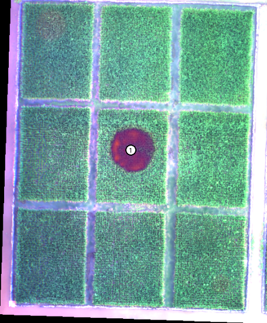
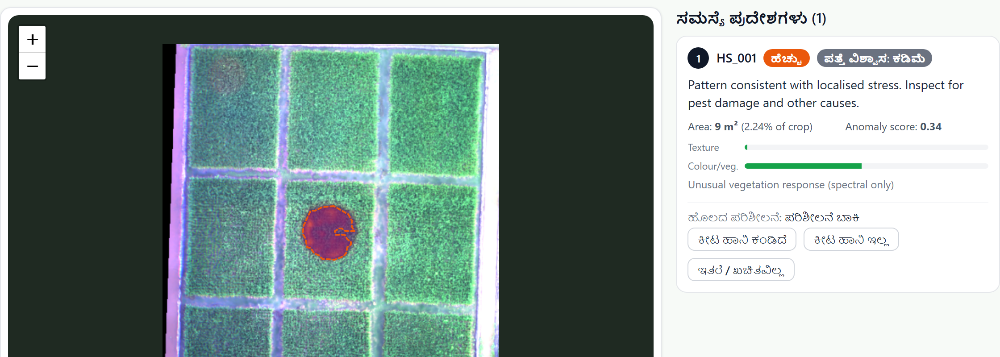
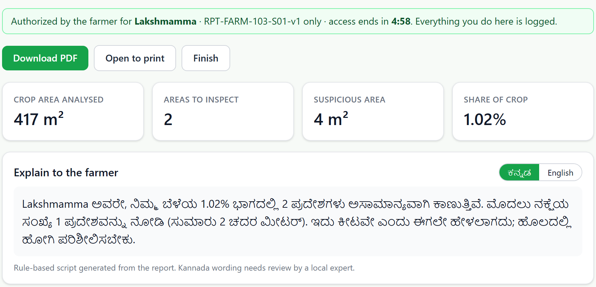
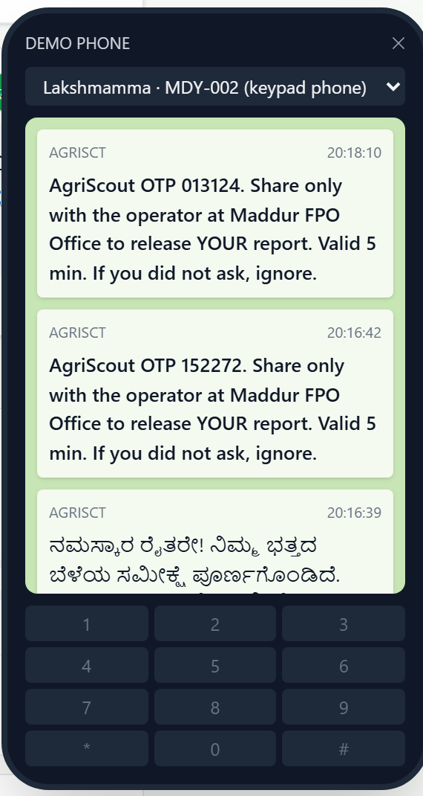

# AgriScout AI

**UAV crop-anomaly hotspot detection for early scouting, delivered to smartphone and keypad-phone farmers.**

AgriScout takes a drone survey of a field and returns a ranked list of places a scout should walk to first, how sure it is about each, and a report the farmer can actually receive. It was built for the hackathon problem *"UAV-Based Pest Infestation Hotspot Detection"* (Drones, Problem 4, Hardware + Software), and it follows that brief's own limit: aerial imagery can point to *possible* infestation zones but cannot confirm the pest, which needs ground inspection. So AgriScout never names a pest. It ranks places to inspect, says how confident it is, and records what scouts find.



## Status: read this first

This is a working end-to-end **prototype**. It runs on real public drone imagery, but **there is no pest-labelled aerial validation**, and no accuracy figure for pest detection is claimed anywhere.

- The two "anomaly" farms in the survey-day simulator use **real rice imagery with simulated stress patches blended in**. The patches are not real pest or disease damage, and every screen and PDF says so.
- On real data the vegetation-index signal was the dependable one. The pretrained visual-texture model (PatchCore) was near chance and is labelled **experimental** everywhere. See [Evidence and limits](#evidence-and-limits).
- No drone was flown and no scout has used it. SMS is a mock gateway, Kannada text is unreviewed, and the demo farmers are fictional.

## Contents

1. [What is in the box](#what-is-in-the-box)
2. [Quick start](#quick-start)
3. [Demo walkthrough](#demo-walkthrough)
4. [How detection works](#how-detection-works)
5. [Repository layout](#repository-layout)
6. [Data: what is not in this repo and how to get it](#data)
7. [Evidence and limits](#evidence-and-limits)
8. [Backend, security and configuration](#backend-security-and-configuration)
9. [Testing](#testing)
10. [Pitch deck](#pitch-deck)
11. [Roadmap](#roadmap)
12. [Licences and attribution](#licences-and-attribution)

## What is in the box

| Part | What it does |
|---|---|
| **Analysis pipeline** (`ml/agriscout_ml/`) | Aligns RGB and multispectral rasters, masks non-crop, scores each field against itself, fuses two signals, extracts hotspot polygons with area, priority, confidence and a pattern hint |
| **Backend** (`backend/app/`, FastAPI + SQLite) | Farmer OTP login, operator-assisted report access, scout verdicts, one stored PDF report per survey, mock SMS, audit log, survey-day simulator |
| **Frontend** (`frontend/`, React + TypeScript + Tailwind + Leaflet) | Farmer dashboard (English / Kannada), operator portal, admin console, survey-day simulator, demo phone |
| **Experiments** (`ml/experiments/`) | The scripts that produced the evidence numbers below |
| **Pitch deck source** (`docs/pitch-deck/`) | The 14 slides, including the limits slide |

Three ways a farmer receives a result, all backed by the same PDF:

1. **Digital farmer:** signs in with a one-time code, sees the map, hotspots and report.
2. **Assisted farmer (keypad phone):** gets an SMS in Kannada, visits a service centre, and an operator releases the report after the farmer enters a one-time code sent to their own phone.
3. **Offline:** the SMS alone tells them the survey is done and where to collect the report.

| Farmer dashboard (Kannada) | Operator portal | SMS inbox (mock) |
|---|---|---|
|  |  |  |

## Quick start

Tested on **Windows 11** with Python 3.12, uv 0.9 and Node 24. Linux and macOS were not tested.

### Prerequisites

- [uv](https://docs.astral.sh/uv/) (it installs the pinned Python 3.12 for you)
- Node.js 20.19+ or 22.12+ (tested on 24) and npm
- Disk: several GB for the Python environment (PyTorch), about 0.7 GB for Playwright's browsers, and roughly 10 GB more if you add the optional real datasets
- Internet on first run: PyTorch wheels, Chromium, and the ImageNet ResNet-18 weights (about 45 MB, downloaded once by torchvision).

### Install

```bash
uv sync                                   # Python dependencies (creates .venv)
uv run playwright install chromium        # headless Chromium, used to render PDF reports
npm --prefix frontend install             # frontend dependencies
```

### Build the demo (no downloads needed)

```bash
uv run python scripts/bootstrap_demo.py
```

This generates four synthetic fields, fits the PatchCore reference on the two normal ones, runs the pipeline on a stressed and a healthy field, and seeds the database with fictional farmers, operators and reports. Add `--reset` to delete and rebuild the database.

### Run

Two terminals, both from the repository root:

```bash
uv run uvicorn backend.app.main:app --port 8000     # API (docs at http://localhost:8000/docs)
npm --prefix frontend run dev                       # UI at http://localhost:5173
```

The UI proxies `/api` to port 8000.

## Demo walkthrough

All logins are fictional demo data. One-time codes are shown in the **Demo phone** button at the bottom right of every page, which stands in for the farmer's phone.

| Who | How to sign in | What you see |
|---|---|---|
| Farmer `MDY-001` (Kannada, smartphone) | `/farmer`, ID `MDY-001`, send code, read it from the Demo phone | Synthetic stressed paddy field with 4 hotspots, scout verdict buttons, PDF |
| Farmer `MDY-003` (English) | `/farmer`, ID `MDY-003` | Real UAV maize mosaic, "no significant anomaly" (needs the optional maize data) |
| Keypad-phone farmer `MDY-002` | Operator portal `/operator`: operator `OP-MAD`, PIN `1234`, look up `MDY-002` | The assisted flow below |
| Admin | `/admin` (demo admin key is prefilled) | Run analyses, send SMS, view the report access log |

**Assisted flow** (`/operator`): operator signs in, finds the farmer by ID (sees only a masked phone number), requests a code, the farmer reads out the code from their phone, the operator enters it and gets that one report for five minutes. Every view and download is logged on the admin page.

**Survey-day simulator** (`/admin` then *Survey-day simulator*): runs a new survey for three farms through the real pipeline. Farm 1 is untouched real rice imagery (result: no anomaly). Farms 2 and 3 have simulated stress patches added (results: 1 and 2 hotspots). Each farm gets a PDF report and an SMS; each farmer's dashboard then opens on the new survey. It needs the rice dataset prepared once, see [Rice survey-day simulator](#rice-survey-day-simulator). Use *Reset simulation* to run it again.

## How detection works

1. **Align and check.** RGB and multispectral rasters are warped onto one metric grid (CRS and resolution are checked, not assumed). Quality checks cover no-data and saturation inside the field boundary. A survey with **no multispectral file** is handled as RGB-only (see below).
2. **Crop mask.** Vegetated pixels inside the field. The NDVI cutoff is chosen from the survey itself (Otsu, bounded 0.20 to 0.40) because absolute NDVI differs by sensor and exposure. Small enclosed gaps are filled so a badly stressed patch inside a plot is not dropped as non-crop.
3. **Vegetation-index baseline (the dependable signal).** NDVI and NDRE are smoothed and scored against the **median and spread of the same field** (robust z-score). A floor means nothing is flagged below a set deviation, so a healthy field returns *"no significant anomaly"* instead of a forced top few percent.
4. **Visual texture check (experimental).** A pretrained ImageNet ResNet-18 plus a PatchCore-style memory bank of *normal* canopy, calibrated on held-out normal imagery. Scores within 1 m of a field boundary are discarded (the model reacts to empty surroundings there).
5. **Fusion.** Weighted average, **70% index and 30% texture** (provisional; chosen after seeing results on the planted patches, so not independent evidence). A single-branch fallback applies if one is missing.
6. **Hotspots.** Threshold, clean, polygonise. Each hotspot gets area, share of crop, an **inspection priority** (how urgently to look, not disease severity), a **detection confidence** (image quality, agreement between the two signals, patch size; not a probability of damage) and a **pattern hint** (compact, elongated, edge-aligned or broad, worded "consistent with…", never a cause).

**RGB-only drones.** Most farm drones have no multispectral camera. Without `multispectral.tif` the pipeline uses an excess-green crop mask and a VARI colour-index baseline, with the same field-relative scoring and floor. VARI is a weaker proxy for vigour than NDRE.

### Survey input

A survey is a folder, for example `data/raw/<name>/`:

| File | Required | Notes |
|---|---|---|
| `rgb.tif` | yes | 3 bands, georeferenced in a **projected** CRS (metres) |
| `multispectral.tif` | no | 4 bands in order **red, green, red-edge, NIR**, reflectance 0 to 1 |
| `field_mask.tif` | no | 1 inside the field boundary; defaults to the whole raster |
| `survey.json` | no | metadata; set `"reflectance_calibrated": true` **only if true**; without it every multispectral hotspot is rated LOW confidence |
| `truth_mask.tif` | no | known stress locations (used only by the self-check on synthetic or simulated data) |

### Pipeline outputs

Written per run to `data/runs/<id>/`: `rgb.png`, `ndvi.png`, `ndre.png`, `spectral_anomaly.png`, `spectral_z.png` (deviation including sub-threshold values, not an alert layer), `rgb_anomaly.png`, `fused_anomaly.png`, `overlay.png`, GeoTIFFs of the anomaly maps, `hotspots.geojson` and `summary.json`.

### Command line

```bash
# fit the normal reference for the visual check on NORMAL fields only
uv run python -m agriscout_ml.pipeline train --reference data/raw/synthetic/ref1 data/raw/synthetic/ref2 --model data/models/patchcore.pt
# analyse a survey
uv run python -m agriscout_ml.pipeline run --survey data/raw/synthetic/stressed --model data/models/patchcore.pt --out data/runs/stressed --survey-id stressed
# omit --model to run the index baseline alone
```

With one reference survey `train` uses a spatial split (fit on the top 65%, calibrate on the bottom 30%); with two or more it fits on all but the last and calibrates on the last. **Never calibrate or fit on the imagery you then score.**

## Repository layout

```
ml/agriscout_ml/        analysis pipeline
  io.py                 load and align rasters, quality checks
  spectral.py           indices, crop masks, field-relative scores (multispectral and RGB-only)
  patchcore.py          pretrained-feature memory bank (experimental visual check)
  hotspots.py           fusion, polygons, priority, confidence, pattern hints
  pipeline.py           train / run entry points and stage reporting
  render.py             PNG layers and overlays
  synth.py              synthetic survey generator (for tests and the base demo)
  simulate.py           survey-day simulator inputs: real rice imagery + simulated stress
  mosaic_blb.py         stitches the rice dataset's patches into orthomosaics
  blb_index.py          extracts the rice dataset and builds its patch index
  convert_zenodo_maize.py   converts the maize orthomosaics to the survey layout
  eval_labels.py        threshold-free AUROC against a labelled class raster
ml/experiments/         scripts behind the evidence numbers
ml/tests/               unit tests and the browser end-to-end test
backend/app/            FastAPI app: routes, models, security, ingest, reports, sms, simulation, seed
backend/tests/          API flow tests
frontend/src/           React app: pages, components, i18n (English, Kannada), API client
scripts/bootstrap_demo.py   one-command demo setup
docs/img/               README screenshots
docs/pitch-deck/        pitch deck slide source
data/experiments/       small result files that back the README numbers (everything else under data/ is generated)
```

## Data

Datasets, trained models, run outputs and the database are **not committed**. Everything under `data/` except `data/experiments/` is generated or downloaded. The base demo needs none of it (`scripts/bootstrap_demo.py` makes synthetic fields). The real datasets below are optional and each has its own licence.

| Dataset | Used for | Licence | Size | Status |
|---|---|---|---|---|
| UAV multispectral maize, water stress and common rust (Zenodo, v2.1) | Real top-down mosaic in the demo; cross-field tests | CC BY 4.0 | 1.4 GB zipped | Used |
| UAV bacterial leaf blight in paddy rice (figshare, Thailand) | Real rice imagery for the survey-day simulator; blight-severity test | CC BY 4.0 | 3.8 GB zipped | Used |
| CADI-AI cashew (Hugging Face) | Close-range pest / disease / abiotic test of the visual check | CC BY-SA 4.0 | 0.9 GB | Used for evaluation only |
| IMPaCT-UAV Indian paddy (IEEE DataPort) | Intended | CC BY 4.0, but **subscription-only** | 415 GB | **Not obtained** |

Use v2.1 of the maize set: an earlier release had the red-edge and NIR band labels swapped.

### Maize field (optional demo farm `MDY-003`)

```bash
# 1. download from https://doi.org/10.5281/zenodo.22062459 (v2.1): 01_orthomosaics.zip and 02_processed_patches.zip
#    unzip so that these exist:
#    data/raw/zenodo_maize/ortho/{common_rust_2025,water_stress_2025}/*.tif
#    data/raw/zenodo_maize/patches/{rust_2025,water_2025}/full_masks/*.tif

# 2. convert both mosaics to the survey layout at 5 cm
uv run python -m agriscout_ml.convert_zenodo_maize data/raw/zenodo_maize/ortho/water_stress_2025/positive_output.tif data/raw/maize_water --gsd 0.05
uv run python -m agriscout_ml.convert_zenodo_maize data/raw/zenodo_maize/ortho/common_rust_2025/Processed_Orthomosaic.tif data/raw/maize_rust --gsd 0.05

# 3. fit on one field, analyse the other, then re-seed
uv run python -m agriscout_ml.pipeline train --reference data/raw/maize_water --model data/models/maize.pt
uv run python -m agriscout_ml.pipeline run --survey data/raw/maize_rust --model data/models/maize.pt --out data/runs/maize_rust --survey-id FARM-003-S01
uv run python scripts/bootstrap_demo.py --reset
```

Note the source metadata lists nodata as -10000 but the pixels do not use it; the converter uses the alpha band instead. The 2 cm conversions used by `ml/experiments` are the same command with `--gsd 0.02` into `data/raw/maize_water_g02` and `data/raw/maize_rust_g02`.

### Rice survey-day simulator

The dataset's files are on Google Drive and scripted downloads are rate-limited, so download the folder **in a browser** from the link in its [figshare record](https://doi.org/10.6084/m9.figshare.26955862) and place the zip parts in `data/raw/blb/drive/`.

```bash
uv run python -m agriscout_ml.blb_index --zips "data/raw/blb/drive/*.zip"   # extract patches and masks (~2.8 GB) and index them
uv run python -m agriscout_ml.simulate data/raw/sim --train data/models/sim_rice.pt
```

The second command stitches the healthy site into a mosaic, splits it into four blocks (one reference block used only to fit the visual check, one untouched, two with simulated stress), and writes the surveys the simulator uses. Then open `/admin`, *Survey-day simulator*, *Start survey day*.

### Cashew evaluation (optional)

Download `KaraAgroAI/CADI-AI` from Hugging Face, unzip `Data/{train,val,test}.zip` into `data/raw/cadi/{train,val,test}/`, then `uv run python ml/experiments/cadi_eval.py`. Class ids were inferred from label counts (0 abiotic, 1 disease, 2 insect); the dataset's own README lists a different order.

## Evidence and limits

Numbers are AUROC (0.5 is chance, 1.0 is perfect) from `ml/experiments/`, with raw results in `data/experiments/`. They are **proxy tests, not pest-detection accuracy.**

| Test | Data and labels | Result |
|---|---|---|
| Planted stress on real rice | Top-down real plots; 7 simulated patches over 2 farms | **3 of 7 found**, all strong (severity 0.7 or more); nearly every flagged pixel inside a patch; mild and small patches missed |
| Maize, two real fields | Top-down; labels derived from the vegetation index | Index 0.78 to 0.94; VARI 0.63 to 0.64; visual check 0.56 to 0.66 |
| Rice blight severity | Top-down; expert plot-level labels, high vs low severity | Index 0.64 to 0.65; VARI 0.59; visual check 0.54 |
| Cashew | **Close-range, oblique (not aerial)**; human-drawn boxes | Visual check 0.65 to 0.73; VARI 0.61 to 0.72 |

What this does and does not support:

- **No public top-down pest-labelled data was found**, so detection of real pests from altitude is untested. The scout verdict loop exists to create exactly that data.
- The maize labels come from vegetation-index thresholds, which favours the index and says little about the visual model.
- In the rice blight set, healthy and diseased rice are in **different fields** (found by clustering patch coordinates), and the authors' random split puts every test patch beside a training patch. Healthy-vs-blight scores are confounded by site, so only the within-site severity comparison is reported. Low and high severity are nearly spectrally identical (mean NDVI 0.205 vs 0.193).
- A reference learned at one site did not transfer to another, which is why each field is scored against itself. The cost: **a uniformly stressed field produces no outlier and passes.**
- The fusion weight and all thresholds are provisional and unvalidated against ground truth.
- Every hotspot shows low confidence on the rice imagery because the dataset does not state its radiometric calibration.
- Farms, farmers and operators are fictional. The demo places imagery from public datasets collected elsewhere (Thailand for the rice, outside India for the maize) in fictional Mandya farms; the banners explain this.

## Backend, security and configuration

**Stack:** FastAPI, SQLModel on SQLite (`data/agriscout.db`), headless Chromium for PDFs (so Kannada text is shaped correctly), a mock SMS provider behind an interface.

### Access model

- **Farmer login:** a six-digit one-time code sent to the registered phone. The response is identical whether or not the Farmer ID exists (no ID enumeration).
- **Codes** are stored as salted HMAC hashes, are **single-use**, expire in **5 minutes**, lock after **3 wrong tries**, and are rate-limited to 3 requests per 10 minutes per farmer.
- **Assisted access:** the operator never sees the code. A verified code gives the operator an access token for **one report, for 5 minutes**; a token for one report does not open another. Every view and download is written to an audit log.
- **One PDF per survey**, generated once and stored; the dashboard and the operator desk serve the same file.
- A one-time code proves control of the registered phone, **not identity**. A real deployment needs a documented FPO-verified fallback.

### Main endpoints

Interactive docs at `/docs`. Prefixes: `/api/farmer` (login, survey, layers, report), `/api/hotspots/{survey}/{hotspot}/verdict` (scout verdicts), `/api/assisted` (operator login, lookup, code request and verification, report summary and download), `/api/admin` (analyses, notify, overview, simulator, layers, reports), `/api/dev/sms` (demo SMS outbox) and `/api/health`.

### Configuration

| Variable | Default | Purpose |
|---|---|---|
| `AGRISCOUT_SECRET` | `dev-only-secret-change-me` | HMAC key for codes and tokens. **Set this outside local development.** |
| `AGRISCOUT_ADMIN_KEY` | `demo-admin` | Admin API key. **Change it.** |
| `AGRISCOUT_DEMO` | `1` | When `1`, `/api/dev/sms` exposes the SMS outbox, **including one-time codes**, so the demo phone works. Set `0` anywhere real. |
| `AGRISCOUT_DB` | `data/agriscout.db` | SQLite path |

Operator PINs in the seed are all `1234`. CORS allows only `localhost:5173`. This is a prototype and has not had a security review.

### Real SMS

SMS is a mock outbox. Real Indian SMS needs a DLT-registered sender ID and pre-approved templates, and Kannada text must be sent as Unicode (70 characters per segment). Implement the provider interface in `backend/app/sms.py` to switch.

## Testing

```bash
uv run pytest ml/tests backend/tests -q       # 18 unit and API-flow tests
```

The browser end-to-end test (36 checks: login, verdicts, PDFs, admin, the survey-day simulator, SMS) needs both servers running, the demo seeded, and the optional maize and rice data prepared:

```bash
uv run --with requests --with pypdfium2 python ml/tests/e2e_ui.py data/e2e
```

It leaves the database changed (it records a verdict and runs analyses), so re-run `scripts/bootstrap_demo.py --reset` afterwards.

Unit tests cover the plumbing and the no-false-alarm behaviour on synthetic fields. They do **not** measure real pest-detection accuracy.

## Pitch deck

The 14-slide deck, including the limits slide, was built as a slides artifact. Its HTML source is in `docs/pitch-deck/` (`deck.json` plus `slides/*.html`, each speaker-noted). Image references in the slides point at assets stored in the original artifact, so they will not display outside it; the same screenshots are in `docs/img/`.

## Roadmap

Each item closes a limit above:

1. **Walk the hotspots.** Scouts record verdicts on real farms; these become the first field-verified labels and let us report a false-alarm rate.
2. **Fly it properly.** One field at three altitudes with a reflectance calibration panel; find the smallest patch detectable at each.
3. **A second survey date.** Tag patches as new, growing or stable.
4. **Tune on verified fields.** Set thresholds and fusion weights from plotted detection against false alarms.
5. Kannada review by an agricultural expert; real SMS delivery; an FPO-verified identity fallback.

## Licences and attribution

**Code:** no licence has been chosen yet, so all rights are reserved by default. Add a `LICENSE` file before others reuse it.

**Datasets** (not redistributed here; each keeps its own licence):

- Suiçmez, Ç., Yilmaz, C., & Kahraman, H. T. (2026). *UAV-Based Multispectral Maize Dataset for Water Stress 2025 and Common Rust 2025 Detection* (v2.1). Zenodo. https://doi.org/10.5281/zenodo.22062459 (CC BY 4.0). The authors also ask for citation of: Suiçmez, Yilmaz & Kahraman (2026), *A Multi-Head UNet++ Framework with Fractional Differential Output Refinement for UAV Multispectral Crop Stress Mapping*, Sensors 26(10), 3228. https://doi.org/10.3390/s26103228
- Logavitool, G., Intarat, K., & Thapa, A. (2025). *Bacterial Leaf Blight (BLB) UAV Dataset*. figshare. https://doi.org/10.6084/m9.figshare.26955862 (CC BY 4.0). Cite: Logavitool, Horanont, Thapa, Intarat & Wuttiwong (2025), *Field-scale detection of Bacterial Leaf Blight in rice based on UAV multispectral imaging and deep learning frameworks*, PLOS ONE 20(1), e0314535.
- KaraAgro AI Foundation, *CADI-AI* cashew dataset, Hugging Face `KaraAgroAI/CADI-AI` (CC BY-SA 4.0). Used for evaluation only.

The screenshots in `docs/img/` and the deck show imagery derived from the rice dataset (with simulated stress where marked) and carry the same attribution.

Pretrained weights: torchvision ImageNet ResNet-18, downloaded at run time.
